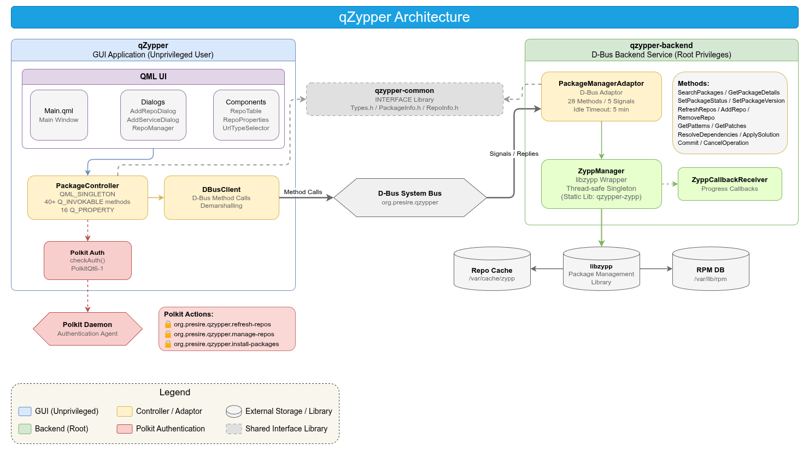
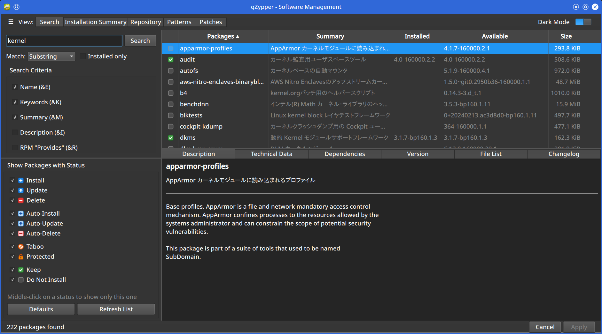
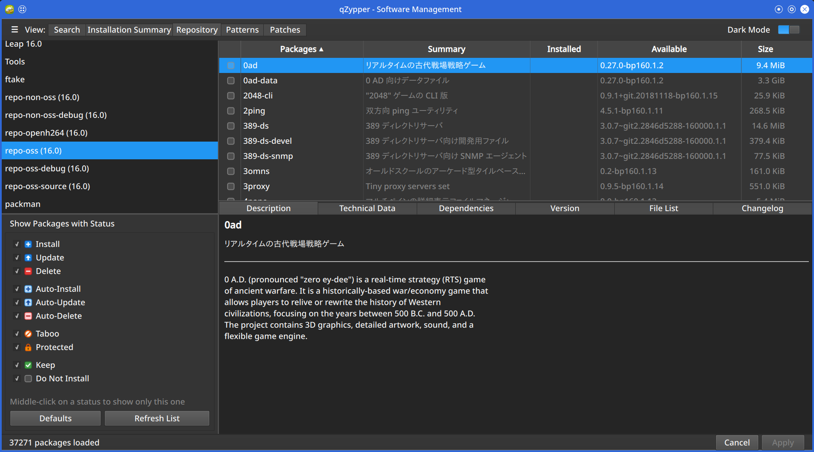
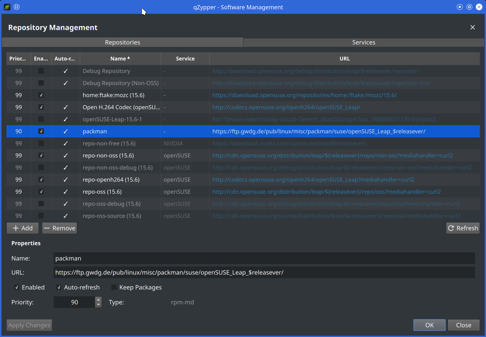
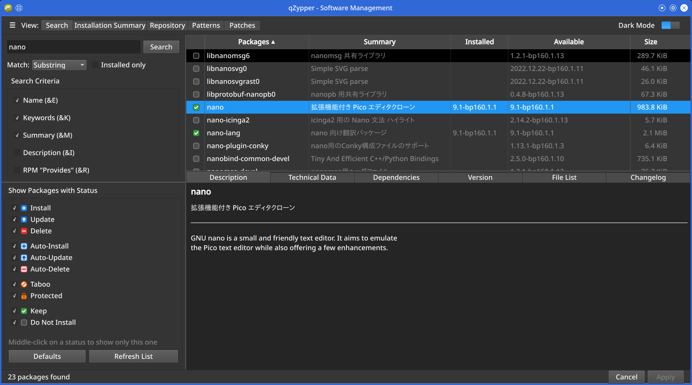

# qZypper

**A modern GUI package manager for openSUSE Leap 16 / SLE 16**  

> Successor to **YaST Software Management** and **YaST Repository Management**,  
> built with Qt 6 (QML) and libzypp.  

---

  
  

## Overview

qZypper is a graphical package management tool designed as a replacement for YaST Software Management and  
YaST Repository Management on openSUSE Leap 16 and SUSE Linux Enterprise 16.  

It provides a unified interface for managing packages,  
repositories, services, patterns, and patches through a modern Qt Quick UI,  
with privileged operations handled securely via D-Bus and Polkit authentication.  

## Features

### Package Management

- Search packages by name, keywords, summary, description, provides, requires, and file list
- View detailed package information (description, dependencies, changelog, file list)
- Install, update, and remove packages with dependency resolution
- Browse packages by repository or software pattern
- Select specific package versions from multiple repositories
- Set package status: install, update, delete, taboo, protected

### Repository Management

- List, add, remove, and modify repositories
- 2-step wizard for adding repositories (URL, then properties) with URL scheme validation
- Refresh individual or all repositories with progress indication
- Configure priority, auto-refresh, and package caching per repository

### Service Management

- Add, remove, and modify RIS/plugin package services
- Refresh services (auto-adds associated repositories)

### Pattern & Patch Management

- Browse and install software patterns grouped by category
- View and apply patches by category: security, recommended, optional, feature

### Dependency Resolution

- Automatic dependency resolution via libzypp solver
- Interactive conflict resolution with multiple solution options
- Preview pending changes before committing

### Security

- D-Bus privilege separation (GUI runs unprivileged, backend runs as root)
- systemd-managed D-Bus activation (backend runs as root under a dedicated systemd service)
- Environment sanitization in the systemd unit (fixed `HOME`/`PATH`, inherited variables unset)
- Polkit authentication for privileged operations
- SELinux policy module for Leap 16 / SLE 16
- Dedicated SELinux GPG-agent socket type (`qzypper_gpg_agent_socket_t`) with a socket type transition (policy configuration)

### Internationalization

- English (default) and Japanese language support
- Automatic locale detection and translation loading

## User Interface

### Main Window Tabs

The header toolbar provides four view tabs.  

| Tab | Description |
|---|---|
| **Search** | Search packages by keyword with configurable search filters |
| **Installation Summary** | Review all pending changes (install / update / delete) before committing |
| **Repository** | Browse packages grouped by repository |
| **Patterns** | Browse and install software patterns grouped by category |

### Navigation Drawer

The hamburger menu (☰) opens a left-side drawer with the following sections.  

- **Packages** — Update All Packages, Apply Changes
- **Settings** — Manage Repositories, Refresh Repositories
- **Help** — About qZypper, About Qt
- **Quit**

### Repository Manager Drawer

A full-screen right-side drawer with two tabs.  

- **Repositories** — List, add, remove, and edit repositories with a properties panel (priority, enabled, auto-refresh, keep packages)
- **Services** — List, add, remove, and refresh RIS/plugin package services

### Package Details Pane

The bottom pane displays detailed information for the selected package across six tabs.  

| Tab | Content |
|---|---|
| **Description** | Package name, summary, and full description |
| **Technical Data** | Size, architecture, vendor, build time, etc. |
| **Dependencies** | Requires, provides, conflicts, obsoletes |
| **Version** | Available versions from all repositories with version selection |
| **File List** | Files included in the package |
| **Changelog** | Package change history |

### Refresh Progress Overlay

A modal overlay displayed during repository refresh operations,  
featuring a progress indicator, status message, and cancel button.  
Press `Escape` or click the cancel button to cancel the operation; the refresh stops the in-progress repository's libzypp call as soon as it observes the cancellation request.  

## Architecture

  

| Target | Type | Description |
|---|---|---|
| `qzypper` | Executable | GUI application (Qt Quick / QML) |
| `qzypper-backend` | Executable | D-Bus backend service (root, libzypp) |
| `qzypper-zypp` | Static library | ZyppManager (isolated from Qt D-Bus) |
| `qzypper-common` | Interface library | Shared type definitions (PackageInfo, RepoInfo, etc.) |

## Screenshots

<h3 align="center">Package Search</h3>

  

<h3 align="center">Browse by Repository</h3>

  

<h3 align="center">Repository Management</h3>

  

<h3 align="center">Package Details</h3>

  

## Requirements

| Dependency | Version | Purpose |
|---|---|---|
| CMake | 3.21+ | Build system |
| GCC | 14.3+ | C++17 compiler |
| Qt 6 | 6.5+ | Core, Quick, QuickControls2, DBus, LinguistTools, Svg |
| libzypp | latest | Package management library |
| PolkitQt6-1 | latest | Polkit authentication (optional, with fallback) |
| Boost.Thread | 1.86+ | Thread management for ZyppManager (imported Boost::thread target linked into qzypper-zypp) |

## Documentation

- [Build and Installation](docs/BUILD.md) — build dependencies, build options, install, installed files, SELinux policy, directory structure
- [D-Bus Interface](docs/DBUS_INTERFACE.md) — backend activation and lifetime, authorization, Polkit actions, methods, signals
- [Configuration File](docs/CONFIGURATION.md) — user settings saved in `~/.config/Presire/qZypper.conf`

## Keyboard Shortcuts

| Shortcut | Action |
|---|---|
| `[Ctrl] + [Q]` | Quit application |
| `[Ctrl] + [Enter]` | Apply pending changes |
| `[Esc]` | Close current drawer / dialog |

## License

This project is licensed under the **GNU General Public License v2.0 or later** - see the [LICENSE](LICENSE) file for details.  

Copyright (C) 2026 Presire  

## Author

**Presire**  

- GitHub: [https://github.com/presire/qZypper](https://github.com/presire/qZypper)
